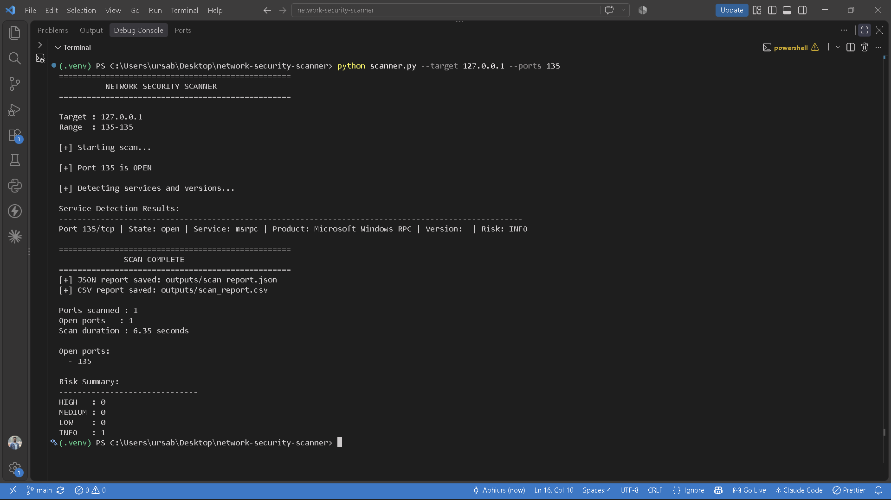
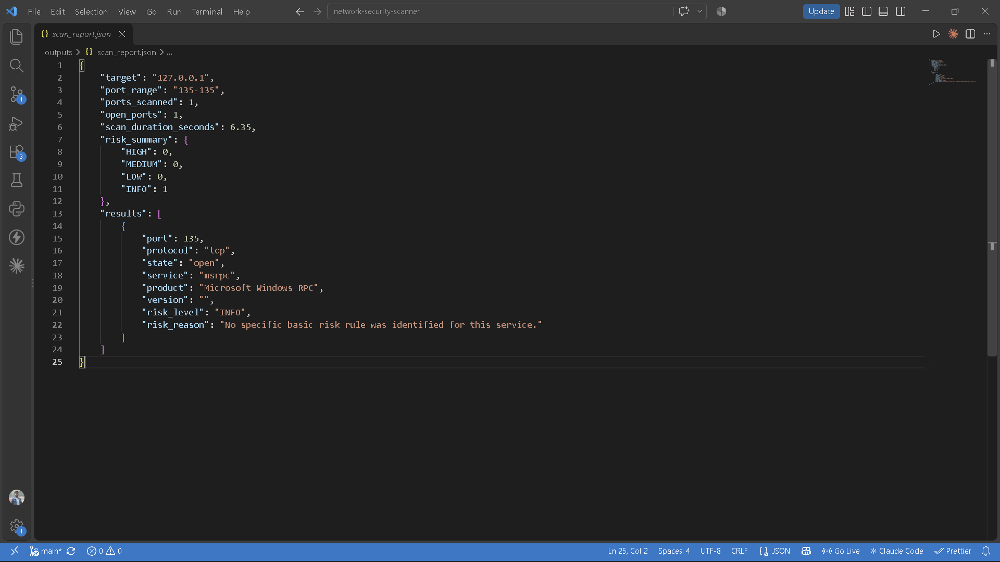
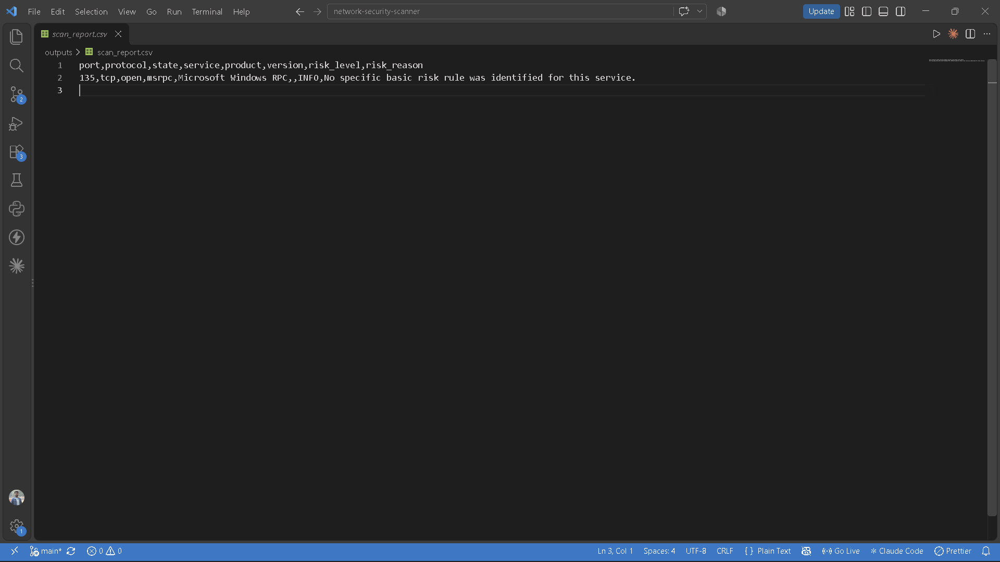

# Network Security Scanner

A Python-based network security tool that scans TCP ports, identifies services and versions using Nmap, highlights basic security risks, and generates JSON and CSV reports.

## Overview

The Network Security Scanner is a command-line project built to explore fundamental network security concepts through practical implementation. It combines Python socket programming, concurrent port scanning, Nmap service detection, rule-based risk analysis, and structured report generation.

The project is intended for learning and authorized security assessment of systems you own or have permission to test.

## Features

- **TCP port scanning:** Checks whether TCP ports are open or not reachable.
- **Concurrent scanning:** Uses Python's `ThreadPoolExecutor` to scan multiple ports concurrently.
- **Configurable scanning:** Supports a target IPv4 address, port or port range, thread count, and connection timeout.
- **Service and version detection:** Uses Nmap to identify services and available product/version information on open ports.
- **Basic risk analysis:** Applies predefined rules to highlight services that may require security review.
- **JSON reporting:** Saves structured scan metadata, service results, scan duration, and a risk summary.
- **CSV reporting:** Exports detected service results in a tabular format.
- **Input validation:** Checks target IP addresses, port ranges, thread counts, and timeout values.
- **Error handling:** Handles common Nmap execution failures, timeouts, and invalid XML output.

## Technologies Used

- Python 3
- Python `socket` module
- `concurrent.futures`
- `argparse`
- `ipaddress`
- Nmap
- XML parsing with `xml.etree.ElementTree`
- JSON and CSV
- Git and GitHub
- Visual Studio Code

## Project Structure

```text
network-security-scanner/
├── scanner.py
├── nmap_detector.py
├── risk_analyzer.py
├── report_generator.py
├── .gitignore
└── README.md
```

Generated scan reports are saved in the `outputs/` directory, which is excluded from version control.

## How It Works

1. The user supplies a target IPv4 address and port or port range.
2. The scanner validates the input.
3. Python TCP socket connections are used to check the specified ports concurrently.
4. Open ports are passed to Nmap for service and version detection.
5. The risk analyzer applies predefined rules to the detected services and ports.
6. The report generator saves the results as JSON and CSV files.
7. The terminal displays the scan summary and risk counts.

## Installation and Setup

### Prerequisites

- Windows, Linux, or another compatible operating system.
- Python 3.11 or a compatible Python 3 version.
- Nmap installed and available through your system's `PATH`.
- Git (optional, for cloning the repository).

### 1. Clone the Repository

```bash
git clone https://github.com/abhiurs/network-security-scanner.git
cd network-security-scanner
```

Alternatively, download the repository ZIP file from GitHub and extract it.

### 2. Create a Virtual Environment

On Windows PowerShell:

```powershell
python -m venv .venv
```

Activate it:

```powershell
.\.venv\Scripts\Activate.ps1
```

If PowerShell blocks activation, use a terminal with the appropriate permissions or follow Python's virtual-environment documentation.

### 3. Install Nmap

Install Nmap from its official website:

https://nmap.org/download.html

Verify that it is available:

```powershell
nmap --version
```

If the command is not recognized, check the installation and system `PATH`.

No additional Python packages are currently required by the project's source files because they use Python's standard library.

## Usage

Run the commands from the project root with the virtual environment activated.

### Scan a Single Port

```powershell
python scanner.py --target 127.0.0.1 --ports 135
```

### Scan a Port Range

```powershell
python scanner.py --target 127.0.0.1 --ports 1-1000
```

### Configure Threads and Timeout

```powershell
python scanner.py --target 127.0.0.1 --ports 1-1000 --threads 100 --timeout 0.5
```

Here, `--threads 100` sets the maximum number of concurrent workers, and `--timeout 0.5` sets the socket connection timeout in seconds.

### View Available Arguments

```powershell
python scanner.py --help
```

### Output Files

After a scan, the project generates:

- `outputs/scan_report.json`
- `outputs/scan_report.csv`

The reports are overwritten by subsequent scans using the same filenames.

## Screenshots

### 1. Terminal Scan Results

Shows the TCP port scan, Nmap service detection, scan duration, and risk summary.



### 2. JSON Report

Shows the scan metadata, detected services, and risk summary in JSON format.



### 3. CSV Report

Shows the detected service information and risk-analysis results in CSV format.



## Risk Analysis

The current rule-based analyzer assigns the following labels:

| Risk Level | Example rule |
|---|---|
| HIGH | Telnet or TCP port 23 |
| MEDIUM | FTP or TCP port 21; SMB or TCP port 445 |
| LOW | SSH or TCP port 22; HTTP or TCP port 80 |
| INFO | HTTPS or TCP port 443; services without a matching rule |

These labels are basic heuristics intended to highlight services for further review. They do not confirm that a vulnerability exists. Actual risk depends on factors such as service configuration, authentication, patch status, network exposure, and the environment.

## Testing

The project has been manually tested for:

- Valid and invalid IPv4 addresses.
- Valid ports, invalid port boundaries, and malformed ranges.
- Single-port and port-range scans.
- Open and closed ports on the local machine.
- Nmap service detection.
- Risk-analysis rules.
- JSON and CSV report generation.
- Nmap executable failures, timeouts, command failures, and invalid XML output.

Results may vary depending on the operating system, firewall, installed services, Nmap version, and target configuration.

## Limitations

- Supports IPv4 targets only.
- Scans TCP ports; UDP scanning is not implemented.
- Service detection depends on Nmap being installed and accessible.
- Service/version information may be incomplete.
- Risk classifications are rule-based and do not constitute vulnerability verification.
- JSON and CSV reports currently contain detected service results rather than a full record of every closed or filtered port.
- The tool is a learning project, not a replacement for a professional vulnerability scanner or a full security assessment.

## Responsible Use

Use this tool only on systems you own or have explicit permission to assess. Scanning systems without authorization may violate applicable laws, policies, or terms of service.

## Author

**Abhinandan Raje Urs M B**

GitHub: https://github.com/abhiurs

## License

No license has been added yet. Unless a license is added, others do not automatically receive permission to redistribute or modify this project.
